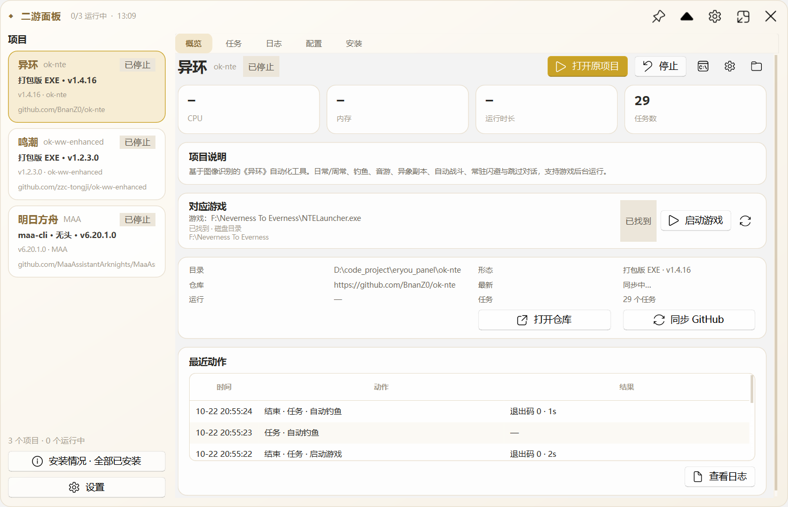
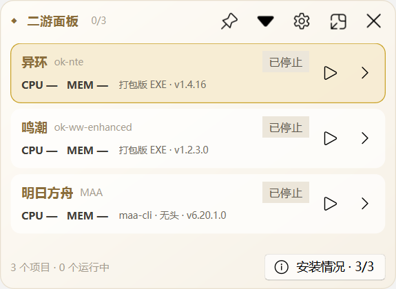
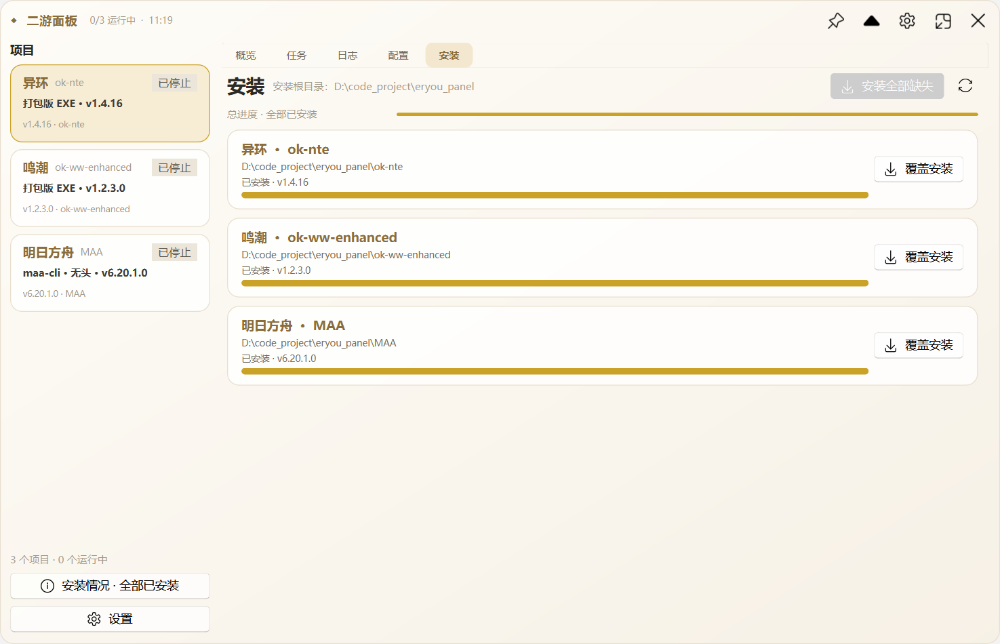
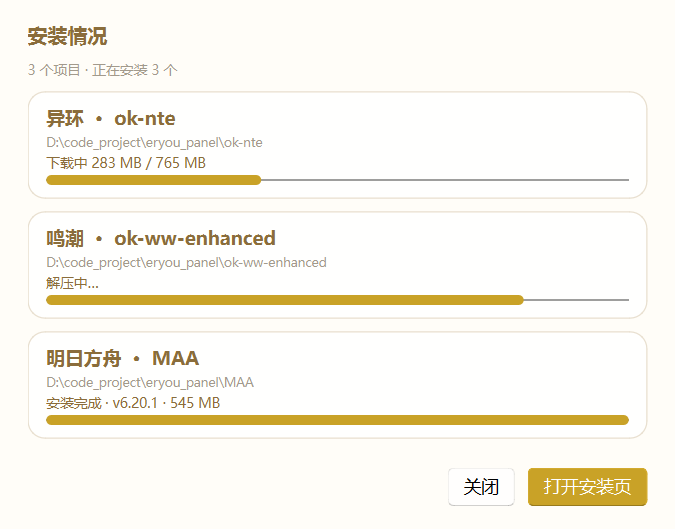

# 二游面板

> 异环 · 鸣潮 · 明日方舟 —— 三个游戏自动化项目的**桌面悬浮监控面板**。
> 暖白 + 香槟金 · 圆角亚克力 · 无边框置顶 · 托盘常驻 · **管理员启动**。

`EryouPanel.exe` 是一个 **PySide6 / Qt 6** 桌面程序：紧凑时是一个始终置顶的监控悬浮窗，展开后是可完成全部管理操作的控制台。它复用现有 Python 后端，运行时不需要 Python 环境。

> ⚠️ 本 EXE 已嵌入 **requireAdministrator** 清单，必须管理员权限运行。
> 双击后在 UAC 弹窗点“是”，或右键 `EryouPanel.exe` → **以管理员身份运行**。
> 详见根目录 **`读我.txt`**。

> 面板只修改自己的目录和运行时数据：不修改 ok-nte / ok-ww / MAA 的源码或二进制。
> 面板只负责安装、自动更新、启动和监控；任务、角色、关卡等都在原项目内操作。





> 截图来自控件渲染；实际窗口由 `qframelesswindow` 开启 Windows Acrylic/Mica 与 DWM 阴影、圆角。

---

## 为什么是这套技术栈

先调研了同类「监控悬浮窗」项目的实际选型：

| 项目 | 技术栈 | 特点 |
| --- | --- | --- |
| [TrafficMonitor](https://github.com/zhongyang219/TrafficMonitor) | C++ / MFC + Win32/DWM | 1.3 MB，经典桌面悬浮窗、任务栏嵌入、皮肤 |
| TrafficMonitor WPF 重制版 | .NET 8 + WPF | 透明置顶悬浮窗，XAML 主题自适应 |
| ModernFlyouts / FluentFlyout | C# + WinUI 3 | Mica/Acrylic 浮层，Windows 11 原生质感 |
| 各类 Electron overlay | Electron + 透明 BrowserWindow | CSS 毛玻璃、开发快，但体积与内存高 |

本项目的约束是：**后端已经是 Python**（进程枚举、任务/日志、安装器），并且需要长期常驻、低资源、原生窗口效果。因此选择：

**Python 3.12 + PySide6 6.12 + PySide6-Fluent-Widgets (qfluentwidgets) + qframelesswindow**

- Qt 6 原生无边框、透明、置顶、托盘，资源占用远低于 Electron
- `qframelesswindow` 直接封装 Windows Acrylic/Mica、DWM 阴影与圆角
- `qfluentwidgets` 提供现代控件与图标，和 ok-script 项目本身的 PyQt 技术栈同源
- 直接复用现有后端，不需要重写进程/任务/日志/安装逻辑
- PyInstaller 单文件发布，约 **54 MB**，无需 Python

---

## 功能

**紧凑悬浮窗**
- 三个项目常驻显示：运行状态 / PID / CPU / 内存 / 运行时长 / 当前任务
- 每行可直接启动或停止；点击行或 `›` 打开详情
- 鼠标拖动标题栏移动；双击标题栏在紧凑 / 展开之间切换
- 图钉切换始终置顶；关闭默认隐藏到系统托盘

**自动查找游戏**
- 启动后在后台探测本机游戏/模拟器，概览显示路径与运行状态
- 异环：`HTGame.exe`，启动器 `NTELauncher.exe / NTEGlobalGame.exe / NTEGame.exe …`
- 鸣潮：`Wuthering Waves.exe / Client-Win64-Shipping.exe`
- 明日方舟：MuMu / 雷电 / BlueStacks / 夜神 / 逍遥 / Androws 模拟器
- 找到后可一键“启动游戏”；ok-nte/ok-ww 启动官方 GUI，由原项目自己的 LauncherTask 启动游戏；MAA 走 MAA StartUp；`Ctrl+G` 重新查找

**原项目模式**

原开源项目功能太多，面板不再复制任务、日常、刷图、角色配置等界面。

- 三个项目都启动原项目官方 GUI，任务和设置都在原项目里操作
- ok-nte / ok-ww：打开官方启动器/官方 GUI
- MAA：打开 `MAA.exe`
- 面板只负责：安装、自动更新、启动、停止、日志、进程监控、游戏窗口显示

| 原功能 | 面板入口 |
| --- | --- |
| 任务、日常、刷图、角色/关卡配置 | 打开原项目界面 |
| MAA 任务、干员、关卡、设置 | 打开 MAA |
| 运行、停止、日志 | 概览 / 日志页 / 悬浮窗 |
| 安装、更新、版本 | 安装页 |
| 游戏显示屏幕、后台 | 配置页“游戏启动显示” |
| 游戏/模拟器启动 | 概览“启动游戏” / “打开 MAA” |

面板只做启动器和安装/更新管理器；原项目负责自己的任务执行和配置。

**展开控制台**
- 概览：项目说明、CPU/内存/运行时长/任务数、目录、版本、GitHub 最新版本、Star/Issues、最近动作
- 任务：打开原项目界面（ok-nte / ok-ww / MAA）
- 日志：实时跟随、增量读取、过滤、日志文件切换、打开日志目录
- 配置：查看/打开原项目配置目录；任务配置建议在原项目内完成
- 安装：一键安装 / 覆盖安装 / 检查更新 / 自动更新原项目
- 左下角“安装情况”：显示已安装数量，点击打开小窗查看每个项目的安装状态与进度
- 托盘：显示隐藏、置顶、紧凑模式、安装缺失、退出

**安装器**
- 从 GitHub 最新 Release 自动选择 Windows 完整包
- 固定安装到 `<面板目录>/<项目名>`，临时文件在 `.eryou-install-tmp/`，结束删除
- 直连超时自动切换 `gh-proxy.com` / `ghfast.top`，支持 Range 断点续传
- 覆盖安装先备份旧目录，失败自动回滚；写入面板目录 `.eryou-install\<项目>.json` 并回写 `panel.json`（不写入开源项目目录）
- 安装页显示**每个项目的独立进度条**和**总进度**；一项失败会继续安装其余项目，结束后可单独重试
- MAA 安装仍会把 `maa-cli.exe` 放到 `maa-runtime\` 作为兼容/排障工具；原项目 MAA GUI 使用 MAA 自己的配置





---

## 当前已安装

| 游戏 | 目录 | 版本 | 体积 |
| --- | --- | --- | --- |
| 异环 | `ok-nte\` | v1.4.16 完整包 | 约 765 MB |
| 鸣潮 | `ok-ww-enhanced\` | v3.7.4-rc.0 官方便携包 | 约 10 MB，首次启动补齐运行库 |
| 明日方舟 | `MAA\` | v6.20.1 win-x64 | 约 545 MB |

版本显示规则：优先读取原项目自己的 `app.json`（ok-nte v1.4.16）；MAA 读取本地 `MAA.exe` 文件版本（v6.20.1.0）；ok-ww 尚未首次启动时只有启动器，会显示启动器本地版本 v1.2.3.0，官方 GUI 首次运行生成 `app.json` 后自动显示项目版本。

本机已自动找到：

- 异环：`F:\Neverness To Everness\NTELauncher.exe`
- 鸣潮：`F:\Wuthering Waves\launcher.exe`
- 明日方舟：`D:\Program Files\Netease\MuMu Player 12\nx_main\MuMuNxMain.exe`
  - ADB：`D:\Program Files\Netease\MuMu Player 12\nx_main\adb.exe`
  - MAA 支持 MuMu 12；面板仍会检测 MuMu ADB，但任务和设置在 MAA 原项目内操作
  - 默认 `127.0.0.1:16384`；多开或特殊端口会自动从 `vm_config.json` 读取，也可手动改地址后“测试连接”

`panel.json` 中的 `install_root` 固定为 `D:\code_project\eryou_panel`；安装器不写注册表，MAA 的 `config` / `data` 指向面板的 `maa-runtime\`，MAA 安装目录保持原样。

---

## 启动

**右键 `EryouPanel.exe` → 以管理员身份运行**；或双击后在 UAC 弹窗点“是”。

- 默认显示**紧凑悬浮窗**并置顶
- 点击标题栏的折叠图标或双击标题栏 → 展开控制台
- 关闭按钮 → 隐藏到托盘；托盘右键 → 退出
- 双击启动时会自动隐藏控制台；从 PowerShell/cmd 启动时保留控制台以便查看 CLI 输出
- **CLI/脚本模式也必须在管理员 PowerShell 中执行**（EXE 清单要求提权）

### 快捷键

| 快捷键 | 作用 |
| --- | --- |
| `Ctrl+1` / `Ctrl+2` / `Ctrl+3` | 切换项目 |
| `Ctrl+I` | 安装当前项目 |
| `Ctrl+Shift+I` | 安装全部缺失项目 |
| `Ctrl+G` | 重新查找本机游戏/模拟器 |
| `F5` | 重新读取任务与日志 |

### 命令行

```text
EryouPanel.exe                          启动悬浮窗
EryouPanel.exe --tui                    终端界面（仅源码环境，GUI 构建不包含）
EryouPanel.exe --scan                   扫描安装目录并写入 panel.json
EryouPanel.exe --install all            命令行安装全部
EryouPanel.exe --install ok-nte         安装单个项目
EryouPanel.exe --install maa --force    覆盖安装
EryouPanel.exe --install all --root D:\Games\panel
EryouPanel.exe --selftest               打包自检
EryouPanel.exe --version                版本
```

脚本（在管理员 PowerShell 中）：

```powershell
scripts\install.ps1 -Project all
scripts\install.ps1 -Project ok-nte -Force
scripts\install_all.cmd
```

---

## 自动查找游戏

面板启动后会在后台探测本机游戏与模拟器，不需要手动填路径；概览的“对应游戏”卡片会显示路径、状态和“启动游戏”。

| 项目 | 识别对象 | 启动方式 |
| --- | --- | --- |
| 异环 | `HTGame.exe`、`NTELauncher.exe`、`NTEGlobalGame.exe`、`NTEGame.exe`、`NTETWGame.exe` | 优先启动 NTE 启动器 |
| 鸣潮 | `Wuthering Waves.exe`、`Client-Win64-Shipping.exe`、根目录 `launcher.exe` | 优先启动 `launcher.exe` |
| 明日方舟 | MuMu 12 / 雷电 / BlueStacks / 夜神 / 逍遥 / Androws | 启动模拟器；无模拟器时提示手动填写 |
| 明日方舟（本机） | **MuMu 12** + `adb.exe` | 启动 MuMu；打开 MAA 原项目 |

探测顺序：已缓存路径 → 当前运行进程 → 各磁盘第一层目录 → 注册表卸载信息 → Steam 库 → 常见目录/磁盘扫描。
结果会写回 `panel.json`；`Ctrl+G` 或“重新查找”可强制刷新。设置页也可以手动填写“游戏 EXE”。

## 各项目的控制方式

### ok-nte / ok-ww-enhanced（打开原项目）

- 任务页只显示“在原项目中操作”卡片
- 点“打开原项目界面”启动官方启动器/官方 GUI
- 任务、角色配置、自动战斗等全部在原项目界面完成
- 面板负责：安装、自动更新、启动、停止、日志、进程监控、游戏窗口显示
- 不修改原项目，不复制任务界面

### MAA（打开原项目）

- 点“打开 MAA”启动官方 `MAA.exe`
- 任务、干员、关卡、连接、日常配置都在 MAA 原项目内操作
- 面板负责：安装、自动更新、启动、停止、日志、进程监控
- MuMu 12 ADB 检测/安装仍保留，用于排查环境；不再在面板内复制 MAA 任务队列

### 自动更新原项目

安装页新增：

- **检查更新**：每次都重新请求 GitHub 最新 Release，不使用本地版本缓存或第三方付费更新服务
- **自动更新原项目**：勾选后启动时自动检查，有更新就下载并覆盖升级
- **更新会保留用户配置**：ok-nte 的 `data/config` 等、ok-ww 的 `config*`、MAA 的 `config` 会复制回新版本
- 更新前会备份旧目录；失败自动恢复
- 自动更新默认关闭，避免在游戏运行时下载大文件；原项目运行中会跳过并提示
- 安装时再次请求 GitHub Release 资产地址，确保拿到的是最新下载链接

---

## 源码空间

`sources/` 是独立的本地源码空间，不影响已安装项目：

- `sources/ok-nte/`：异环源码快照 + 运行资产
- `sources/ok-ww-enhanced/`：鸣潮源码快照
- `sources/ok-script/`：ok-script 框架源码
- `sources/MAA/`：MAA 源码快照（代码，体积大的资源未下载）

面板配置页有“源码目录”按钮；安装页有“源码下载”卡片，可一键下载/补齐全部源码，进度显示在安装页。源码只写入 `sources/`；MAA 运行时只写入 `maa-runtime/`。详细功能对照见 `sources/FEATURES.md`。

## 配置文件

`panel.json` 与 EXE 同目录（不可写时使用 `%LOCALAPPDATA%\EryouPanel`）：

```json
{
  "version": 1,
  "github_ttl": 900,
  "github_token": "",
  "install_root": "D:\\code_project\\eryou_panel",
  "ui": {
    "compact": true,
    "always_on_top": true,
    "close_to_tray": true,
    "opacity": 0.97,
    "pos": [1200, 60]
  },
  "projects": [ ... ]
}
```

| 文件/目录 | 说明 |
| --- | --- |
| `panel.json` | 项目路径、窗口状态、安装根目录 |
| `history.jsonl` | 启动/停止/退出记录 |
| `panel-logs/` | 面板启动进程的完整输出日志 |
| `github-cache.json` | GitHub 元数据缓存 |
| `.eryou-install/<项目>.json` | 安装标记（面板目录） |

`install_root` 留空 = EXE 所在目录；相对路径按 EXE 目录解析。

---

## 管理员权限

`EryouPanel.exe` 已通过 PyInstaller `--uac-admin` 嵌入 **requireAdministrator** 清单：

- 双击 → Windows UAC 询问 → 点“是”
- 或右键 → **以管理员身份运行**
- 在非管理员终端中直接执行 EXE/脚本会因提权要求失败；请先以管理员身份打开 PowerShell
- 根目录的 **`读我.txt`** 有简短说明

## 从源码构建

环境：Windows 10/11，Python 3.12+。

```powershell
.\build.ps1
```

构建脚本会：检查/安装 PyInstaller 与 PySide6 → 跑测试 → PyInstaller（带 `--uac-admin`）打包 → 输出根目录 `EryouPanel.exe`。
如果构建会话不是管理员，会跳过“启动 EXE 自检”以避免 UAC 弹窗；源码测试与打包仍会执行。

直接运行源码：

```powershell
python app.py          # 悬浮窗
python app.py --tui    # 终端界面（可选）
```

依赖：

```text
PySide6
PySide6-Fluent-Widgets
qframelesswindow
requests
```

---

## 能力边界

- 面板是**进程级控制**：MAA 走 CLI 无头；ok-nte / ok-ww 按上游方式打开官方 GUI，任务在上游界面执行
- 真实背景模糊由 Windows 合成器完成；Qt 无边框窗口使用 Acrylic/Mica，Win11 下同时启用 DWM 圆角与阴影
- 面板不注入游戏进程、不修改游戏文件、不绕过反作弊
- 若项目更新后修改了 CLI/任务清单，按 `F5` 重新读取，或用“命令行”手动执行

## 排障

| 现象 | 处理 |
| --- | --- |
| 只看到小悬浮窗 | 双击标题栏，或点击标题栏的折叠按钮展开 |
| 关闭后找不到 | 右下角托盘图标，双击恢复；右键退出 |
| 双击没有反应 / 提示需要权限 | 在 UAC 弹窗点“是”，或右键“以管理员身份运行” |
| 脚本报 requires elevation | 以管理员身份打开 PowerShell 后再运行 |
| 找不到游戏 | 按 `Ctrl+G` 重新查找；或在设置中手动填写“游戏 EXE” |
| 安装下载超时 | 自动切换镜像并断点续传；仍失败可重试或手动下载 |
| 任务运行失败 | 在原项目内查看日志；检查 EXE / 项目路径和原项目配置 |
| 托盘图标缺失 | 确认 `assets/panel.png` 与 EXE 同目录（单文件包已内置） |

## 免责声明

本项目仅做流程编排、安装与进程管理，不包含任何游戏自动化实现。ok-nte、ok-ww-enhanced、MAA 均为第三方开源项目，使用它们可能违反游戏服务条款并导致账号处罚；请自行阅读各项目的免责声明并承担风险。

## 游戏启动显示与后台

配置页新增“游戏启动显示”卡片，会自动检测本机活动显示屏：

- 显示内置屏幕/外接显示器的名称、分辨率和是否主屏
- 可选择游戏启动到哪一块屏幕，默认优先内置屏幕
- 只移动游戏窗口，不切换主屏、不关闭显示器、不修改 Windows 显示设置
- 可勾选“启动后把游戏放到后台（最小化）”
- 可点“应用到当前游戏”把已经在运行的游戏移动到当前选择的屏幕

实现方式：面板在游戏窗口出现后，先用 Win32 隐藏窗口，移动到目标屏幕，再按设置显示到前台或最小化。独占全屏游戏如果拒绝移动，会提示在游戏内选择对应显示器。

## 代表性扩展项目

除了异环、鸣潮、明日方舟，面板现在内置下列代表性二游自动化项目，可在安装页直接一键安装：

| 游戏 | 项目 | GitHub | 当前最新 |
| --- | --- | --- | --- |
| 原神 | BetterGI | `babalae/better-genshin-impact` | 0.66.0 |
| 星穹铁道 | 三月七助手 | `moesnow/March7thAssistant` | v2026.10.16 |
| 碧蓝航线 | ALAS | `LmeSzinc/AzurLaneAutoScript` | v2026.10.09 |
| 蔚蓝档案 | BAAS | `pur1fying/blue_archive_auto_script` | v1.4.3 |
| 阴阳师 | OAS | `runhey/OnmyojiAutoScript` | v1.0.0 |
| 崩坏3 | HonkaiHelper | `Aues6uen11Z/HonkaiHelper` | v2025.6.28 |
| 少女前线2 | ok-gf2 | `AliceJump/ok-gf2` | v1.2.91 |
| 绝区零 | OneDragon | `DoctorReid/ZenlessZoneZero-OneDragon` | v2.5.6 |
| FGO | FGA | `Fate-Grand-Automata/FGA` | v3068（Android APK） |
| 赛马娘 | UmaAuto | `steve1316/uma-android-automation` | v5.9.1（Android APK） |

- 安装包按项目选择对应的 Windows Release 资产
- 大包通过镜像线路下载，支持进度和失败换线
- 7z / zip / rar 都能解压并定位主程序
- 安装后任务页只提供“打开原项目”，任务在原项目内操作
- 绝区零 OneDragon 的本地测试包已删除，但项目入口保留在项目库

## 自定义添加二游项目

项目列表底部有“添加二游项目”加号块。填写任意 GitHub 仓库地址：

- 自动解析 `owner/repo`
- 自动填充项目名、游戏名和最新 Release
- 自动选择 Windows 压缩包（zip / 7z / rar）
- 加入项目库后即可一键安装、打开原项目和检查更新

自定义项目不预设任务界面，安装后仍然直接打开原项目。

## 安卓总局 / 苹果总局与手机端项目

左侧顶部可切换 **安卓总局 / 苹果总局**：

- 安卓总局显示电脑端工具、安卓工具和 Android APK 项目
- 苹果总局显示纯电脑端工具和声明支持苹果/macOS 的项目
- 每个项目卡片和详情页标注：电脑端/手机端、仅电脑、仅安卓、仅苹果、支持安卓/苹果
- 苹果端安装无法在 Windows 直接完成；面板提供 Apple 安装说明，iOS 设备需要 Apple 设备/PlayCover 环境

### MuMu 一键安装

安卓总局的更新页提供 MuMu 卡片：

- 一键启动/连接 MuMu
- 自动读取 ADB 端口
- 手机端项目下载 APK 后直接 `adb install` 到 MuMu
- 已加入 FGA（FGO Android）和 Uma Android Automation（赛马娘 Android）

### 项目详情更新

项目详情页顶部有“检查更新”，会重新请求 GitHub Release：

- 有更新显示最新版本
- 已是最新时提示“已是最新，不更新”

